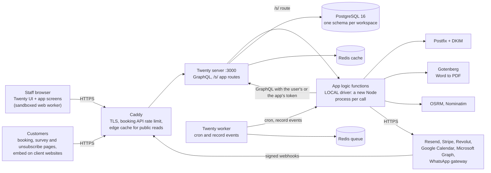
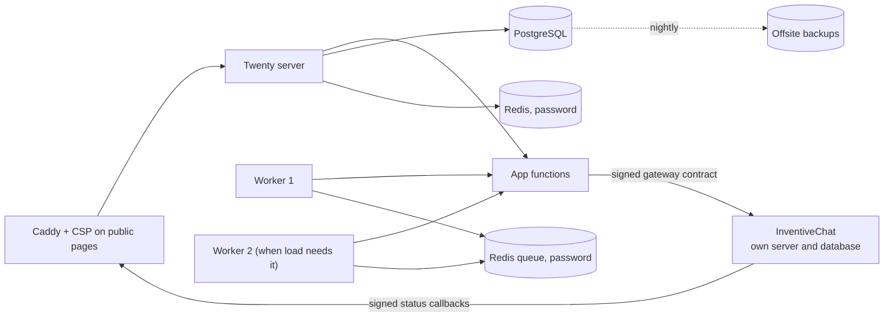

# Architecture audit of the InventiveCRM apps

17 and 18 November 2026. Scope: the five apps built on Twenty (Scheduling, Quotes & Invoices, Campaign Studio, Feedback, Team chat) and the deployment around them. Twenty's own code was read to understand its limits but not changed.

Every number below was measured on this server unless it is marked as an estimate. Scores are provisional where the evidence is thin, and that is said next to them.

## 1. Current architecture

| App | Public routes (no sign-in) | Signed-in routes | Background work | Outside services |
|---|---|---|---|---|
| Scheduling | booking page, booking API, manage link, embed script, staff map (ticket) | admin, sync now, reminders now | calendar sync every 5 min, reminders every 10 min, housekeeping daily; appointment created, updated and deleted events | Google Calendar, Microsoft Graph, OSRM, Nominatim, SMTP |
| Quotes & Invoices | payment key connect page and status, WhatsApp status | send document, payment link, daily run, reconcile | daily billing 06:00, payment reconcile every 10 min; line, quote, invoice and template events | Stripe, Revolut, Gotenberg, SMTP, WhatsApp gateway |
| Campaign Studio | unsubscribe page and one-click unsubscribe, Resend webhook, WhatsApp status, Resend connect page and status | admin (21 actions), run | sending job every 2 min | Resend, WhatsApp gateway |
| Feedback | survey page and survey API | admin, run | job every 15 min | SMTP, WhatsApp gateway |
| Team chat | none | one API with 15 actions | none | none |

How data moves:

- **App screens** run in Twenty's sandbox and post to their app's `/s/<app>/...` route with the viewing user's app token. The function reads and writes through Twenty's GraphQL API. With a user, it gets the intersection of the user's role and the app's role. For work that must not depend on who triggered it, it switches to the app's own token.
- **Public pages** reach the same routes without sign-in and prove themselves with tokens. Booking manage links, survey links and unsubscribe links are HMAC signed with a key per workspace over a random nonce stored on the record. Webhooks are signed: Svix for Resend, and HMAC with a timestamp for the WhatsApp gateway.
- **There is no direct database access from the apps.** Every read and write is a GraphQL call to the same server.
- **Real time is push, through our own realtime service** (`realtime/`, added 18 November). App functions publish which records changed; every open screen of that workspace hears it over Server-Sent Events and re-reads those records through Twenty. An app screen's calls to Twenty go through a proxy that reads whole responses, so it cannot use Twenty's own stream, but its calls to another origin go straight out. Team chat and the WhatsApp inbox use it; nothing polls.
- **Background work** comes from Twenty's worker: cron triggers run per workspace, and record events are queued after commit.

## 2. Measurements

Taken on the test server (a separate Twenty 2.55.0 instance on the same 4-CPU, 8 GB host), 40 requests per route, with `tests/perf/latency.mjs`. "Before" is the app versions that were in production, "after" is the fixed ones.

| Route | p50 before → after (ms) | p95 before → after (ms) | Throughput |
|---|---|---|---|
| Plain GraphQL read (no app code) | 34 → 21 | 67 → 46 | 24 to 41 req/s sequential |
| Booking page details | 963 → 899 | 1,510 → 1,318 | 1 req/s sequential |
| Booking slots for a month | 1,155 → 1,100 | 1,804 → 1,710 | |
| Team chat idle poll | 989 → 799 | 1,897 → 1,021 | |
| Team chat unread counts | 1,174 → 858 | 1,797 → 1,102 | |
| Booking page, 10 at once | 3,113 → 3,440 | 3,512 → 3,784 | 3.2 → 2.9 req/s |
| Team chat poll, 10 at once | 3,529 → 2,465 | 5,501 → 2,863 | 2.6 → 3.9 req/s |

What this shows:

- **Every app route costs about one second whatever it does.** A plain GraphQL read takes 20 to 35 ms. Twenty's LOCAL driver starts a new Node process for each call: it creates a temporary folder, links the dependencies, imports the bundle, then kills the process. Ten callers at once top out at about 3 calls a second on this server.
- **That ceiling decides how far the apps scale on one server, more than any query in them.**
- **The booking page got slightly slower.** The new rate limiter makes three API calls instead of one to three; that is the price of making it race-safe.

Estimates, from the code rather than measured:

- **Team chat, one idle user.** Before: one poll plus one database write every 4 s, so 30 function calls a minute. After: a poll every 4 s while active, 10 s after a quiet minute and 30 s after five quiet minutes, with no write. About 2 calls a minute once quiet, plus unread counts once a minute.
- **Background jobs.** Each workspace runs about 58 cron invocations an hour across the apps: Campaign Studio every 2 min, sync every 5, reminders and reconcile every 10, Feedback every 15. At about 1 CPU-second each, 100 workspaces would keep roughly 1.6 cores busy doing mostly nothing.

## 3. Assessment

| Category | Score | Findings | Priority |
|---|---|---|---|
| Scalability | 4/10 | One server, one Postgres, local file storage. Every app call costs a process start, so about 3 calls/s per server; idle cron load grows with the number of workspaces. The apps now paginate and use indexes, so data volume is no longer the first limit. | P1 |
| Performance | 5/10 | Twenty itself is fast: 21 ms p50 for a GraphQL read. App routes are about 1 s, dominated by process start. Public booking reads are cached at the edge. | P1 |
| Security | 7/10 (after fixes) | Signed links and webhooks, encrypted and sealed chat, guarded test suites. Fixed here: API keys acting with the app's full role, unlimited send loops, a forged pay-now link, a race-prone rate limiter, and a privacy leak of advisor bases. Open: Redis without a password is reachable from app code, functions are not isolated from each other, and booking pages have no CSP. | P0/P1 |
| Efficiency | 6/10 (after fixes) | N+1 loops, idle writes and unbounded scans were removed. Process start per call and cron per workspace remain. | P1 |
| Real-time | 8/10 (after 18 November) | Push through the realtime service: measured in a real browser, an idle screen makes no requests, a WhatsApp message reaches an open inbox about 2 s after InventiveChat sends it, and a reply shows in 60 to 150 ms. Team chat messages reach other screens in about 3 s, because reading encrypted chat costs two app function calls. | P2 |
| Reliability | 7/10 (after fixes) | Nightly backups with a monthly restore drill, upgrade with automatic rollback, and rehearsals of every Twenty release. Jobs are now idempotent with atomic claims, retries and timeouts. Open: backups are on the same disk, it is a single server, and Twenty can lose a record event between commit and queue. | P0/P1 |
| Maintainability | 7/10 | Strict TypeScript and 175 unit tests (108 before). An end-to-end suite per app runs against a test server, and the four apps that share a request helper are checked to stay identical. Some files are large: `booking.ts`, `engine.ts`, `documents.ts`. | P2 |

## 4. Problems found

Status: **Fixed** in this pass (app versions below), or **Open**. "Platform" means Twenty's own behaviour, which the apps can only work around.

| # | Severity | Where | Problem and impact | Fix | Status |
|---|---|---|---|---|---|
| 1 | High | all apps, signed-in routes | Twenty gives a function the app's own full token when the caller used an API key. A read-only integration key could schedule campaigns, send surveys, run jobs or use the scheduling admin. Confirmed in Twenty: `logic-function-executor.service.ts:485`. | Routes that act for a person refuse callers without `userWorkspaceId` (`isSignedInPerson` in each app's `src/lib/api.ts`). | Fixed |
| 2 | High | commercial-docs `documents.ts` (`peekNumber`, `issueInvoice`) | The invoice or quote number was picked, then the PDF rendered, then the number written, so two documents issued at once could share a number. | Numbers are unique fields and are claimed before rendering; on a clash the next number is tried. | Fixed |
| 3 | High | commercial-docs `runRecurringInvoices` | Overlapping runs, or a retried call, could bill a recurring invoice twice; one bad template stopped the whole run. | A unique `recurrenceKey` per parent and date, a try/catch per template, and stuck documents released. | Fixed |
| 4 | High | commercial-docs `payments.ts`, `delivery.ts` | Part payments and credit notes did not change the pay-now amount or reminder text. Issued totals could still change. | Owed = total − paid − issued credit notes; links replaced when the amount differs; issued totals frozen. | Fixed |
| 5 | High | scheduling `lifecycle.ts`, no delete handler | Deleting an appointment kept its time blocked and its calendar events. Cancelling the first seat of a group session freed the host's time. | `appointment.deleted` handler, housekeeping sweep, per-seat release. | Fixed |
| 6 | High | team-chat poll loop | Every open chat screen wrote to the database every 4 s and re-rendered the whole timeline even when nothing changed. | Known rows filtered first, `markRead` only on new messages, sequential polling with backoff. | Fixed |
| 7 | Medium | scheduling `rate-limit.ts` | Read-then-write counter: parallel requests all passed. | One row per request, counted after insert. | Fixed |
| 8 | Medium | scheduling `geo.ts`, public API | An advisor's exact base could be bisected from public "advisors near you" answers. | Public searches snap the customer point to a 0.01° grid. | Fixed |
| 9 | Medium | commercial-docs `delivery.ts` | `channels: ["EMAIL" x 500]` sent hundreds of emails in one call; the pay-now URL was taken from an editable field. | Channels validated and de-duplicated; only the providers' payment hosts are allowed. | Fixed |
| 10 | Medium | campaigns `engine.ts`, `events.ts` | Batches refused for quota stayed claimed and failed 23 h later; idempotent recovery could rebuild a different payload and stall on 409; webhooks could overwrite final statuses. | Release on definite refusal, recovery by batch key from stored snapshots, 409 classified, conditional status moves. | Fixed |
| 11 | Medium | feedback `requests.ts` | Overlapping runs could survey twice; a failed scan moved its cursor and lost customers silently; one failed send was final. | Unique `sourceId`, atomic claim, cursor kept on failure, three attempts. | Fixed |
| 12 | Medium | scheduling reminders and calendar sync | Reminders past the first 500 were never sent, and failures were recorded as sent; reconcile checked the same 50 rows forever. | Ordered, paginated, claimed, retried. | Fixed |
| 13 | Medium | all apps, `api.ts` and SMTP | No timeout on GraphQL or SMTP calls; a proxy error page counted as a permanent failure. | 30 s GraphQL timeout and `TwentyUnavailableError`; SMTP timeouts. | Fixed |
| 14 | Medium | deploy: Redis | Both Redis instances have no password and app code runs in the server container, so a function can reach the queues of every workspace. | `requirepass` on both, with `REDIS_URL` carrying it. | Open |
| 15 | Medium | platform: LOCAL driver | Functions of all workspaces share one container and OS user; only the Node permission model separates them. | Clients stay on the Member role and cannot create code steps (already the rule). | Open |
| 16 | Medium | deploy: backups | Backups are on the same disk as the database. | `BACKUP_OFFSITE_COMMAND` to an offsite store. This costs money, so it waits for your decision. | Open |
| 17 | Low | booking, survey and unsubscribe pages | Served from the CRM's own origin with no Content-Security-Policy; a future XSS there would reach CRM sessions. | A strict CSP header on `/s/book/*`, `/s/booking/manage/*`, `/s/feedback/*` and `/s/campaigns/unsubscribe/*`. | Open |
| 18 | Low | platform: record events | Twenty can lose a record event between the database commit and queueing it (no outbox). | Jobs already re-scan on a schedule, which covers it. | Open |

Each app's README lists what its fix pass changed, and its tests cover it.

## 5. Improvements made in this pass

| App | Version | What changed |
|---|---|---|
| Scheduling | 0.3.6 → 0.4.0 | Signed-in check on admin and job routes. Delete handler and orphan sweep. Group seats fixed. Race-safe rate limiter. Location grid for public searches. Reminders ordered, claimed and retried. Calendar sync ordered with give-up. Sync errors no longer block emails. Slot search loads calendar settings once and runs 6 advisors at a time. Five indexes. |
| Quotes & Invoices | 0.5.4 → 0.6.0 | Unique numbers claimed before rendering. Idempotent recurring billing. Overdue reminders claimed. Frozen issued totals. Owed amount with credit notes. Safe link replacement with a fresh idempotency key. Channel and URL validation. Reconcile made conditional and paged. Longer issue timeouts and a release of stuck documents. Line triggers limited to the fields that matter. Two indexes. |
| Campaign Studio | 0.3.0 → 0.4.0 | Signed-in check. Transient errors pause instead of failing. Refused batches released. Deterministic recovery and 409 handling. Time budget per run. Paced single sends keyed by recipient. One write per batch instead of one per recipient. Conditional webhook updates. Test-send cap. Address re-check before sending. Two indexes. Debounced search and deferred preview. |
| Feedback | 0.1.1 → 0.2.0 | Signed-in check. Unique source and atomic send claim. Scan cursor kept on errors. Retries with backoff. `askNow` limits. Markdown escaped in follow-up tasks. Batched lookups. |
| Team chat | 0.2.2 → 0.3.0 | No write or re-render on idle polls. One poll at a time with backoff. Server clock and a cursor so hidden rows never stall polling. Parallel reads. Unread counts from one scan. Messages of people who left are kept. `lastMessageAt` only moves forward. |
| Shared | | `api.ts`: 30 s timeout, `TwentyUnavailableError`, `isSignedInPerson`. |

Schema changes are additive only; every app's plan reports 0 to destroy.

## 6. Testing

| What | Result |
|---|---|
| Unit tests (`scripts/check-apps.sh`: locked install, strict typecheck, vitest) | 175 passed in all five apps (108 before) |
| End-to-end suites on the test server with the fixed versions | Scheduling 38/38 (2 road-routing checks skipped: no OSRM there), security 8/8, restricted role 2/2, Feedback 13/13, Campaign Studio 39/39, Team chat 35/35, quotes 7/7, rules 9/9, payments 12/12 |
| Upgrade plans on the test workspaces | 0 to destroy for every app |
| Dependency audit (`yarn npm audit`) | Only development tooling is flagged: picomatch ReDoS through vite/vitest, and the unmaintained subscriptions-transport-ws through the generated client. Nothing in the code that runs on the server. |
| Latency | Section 2 |
| Not done | A sustained load test at production scale. Core Web Vitals of the app screens: they render inside Twenty's sandbox and cannot be measured on their own. Real Google, Microsoft, Stripe, Revolut and Resend accounts: the suites use doubles. |

Test changes that came with the fixes:

- Scheduling: the reconcile window is now 14 days, so one case moved from day 8 to day 0.
- Restricted-role check: it books Bob's first free time a week ahead instead of a fixed date that had expired.
- Campaign Studio: a short rate limit is now waited out, so the pause check uses a 60 s retry-after. A refused batch is now sent again under a new key.

## 7. Recommendations

**P0 (before these versions reach clients)**

1. Before installing in production, check each workspace for duplicate invoice numbers, quote numbers and Feedback `sourceId`s, including deleted records. A duplicate makes the new unique index, and so the install, fail.
2. Install in the owner workspace first, as UPDATES.md says. Nothing in production has changed yet.

**P1**

1. Put a password on both Redis instances. This is a production config change and a restart, so it waits for your go-ahead.
2. Set up offsite backups.
3. Watch function load as workspaces are added:
   - lengthen cron intervals where minutes do not matter (Campaign Studio every 2 min only matters while a campaign sends);
   - plan a second worker before a second server. The worker scales out already; the server needs S3 storage first, because files are on a local volume.
4. Add a CSP to the public pages (problem 17).
5. Twenty 2.59.3 is ready except for the app connection flow:
   - it now requires a signed-in browser session and a browser cookie through the connect pages;
   - the end-to-end connect helpers need to sign in like a browser;
   - our connect pages need checking that they carry the cookie through.

**P2**

1. Leftovers the fix passes noted in each app's report:
   - restoring a deleted appointment does not claim its time again;
   - Stripe links on a custom domain lose the Pay now button;
   - the daily-run and reconcile routes still act with the app's role for any signed-in user.
2. Split the largest app files when they are next changed.

**P3 (only if the need appears)**

1. Done on 18 November: the realtime service (`realtime/README.md`). A second instance would need publishes shared between instances (for example Redis pub/sub).
2. Microservices or Kubernetes are not justified by anything measured here. The limit is process start per call, which a second worker or a larger server addresses more cheaply.

## 8. Proposed next shape

The change worth making is the WhatsApp platform (InventiveChat) as a separate service, plus the P1 items. Nothing else needs restructuring.

| What | Trade-off | Needs | Migration |
|---|---|---|---|
| Redis password | None at runtime | A restart | Set `requirepass` and `REDIS_URL`, restart in the maintenance window |
| Second worker | More memory, about 2 GB | Nothing new | `docker compose up --scale worker=2` |
| S3 storage, then a second server | Running cost | An S3 bucket, a load balancer | Copy the storage volume to S3, set `STORAGE_TYPE`, add the upstream |
| InventiveChat | Keeps message data separate | Its domain, HTTPS and the gateway endpoint on its side | See the integration notes given to the user |
